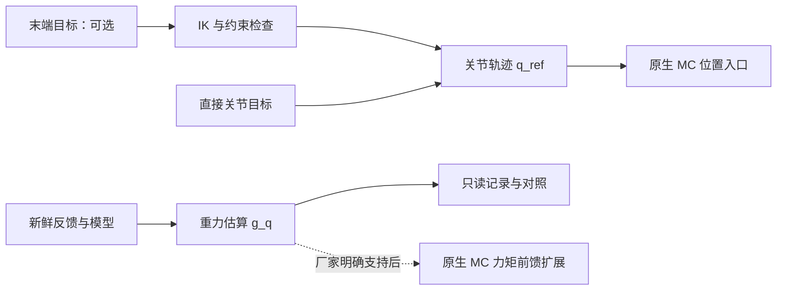

# AimDK 逆运动学、动力学库与重力补偿接入调查

调查日期：2026-10-24。工作区版本文件为 `aimdk v1.1.0-gfaf4c94`。

本次仅在本地检查源码、消息、HTML 文档、URDF 压缩包及 ELF 符号／依赖，并查阅上游文档。没有连接机器人，没有加载动态库、初始化 ROS、构建或执行控制。机器人实际固件内的库、内部补偿和 ABI 尚未检查；历史记录中的 X2 Ultra／夹爪／固件 1.1.5 不能替代本轮版本核对。

## 1. 结论与证据范围

1. **当前 `src/` SDK 没有找到可调用的厂家 IK 或重力补偿算法库、头文件、ROS 服务。** 发现的 12 个 `.so` 路径全部位于 `aimdk_msgs/prebuilt_aarch64/`，属于消息生成和类型支持。这个结论只覆盖本地交付物，不证明机器人固件没有内部算法。
2. **`extra/` 的独立仿真工程确有可计算动力学的动态库：`libmujoco.so.3.3.7`。** 已静态确认其导出 `mj_rne`、`mj_inverse`、`mj_kinematics` 和雅可比函数。但它是 x86-64 仿真依赖，不能直接链接到机器人 aarch64 容器，也不是当前 AimDK 上肢控制的补偿 API。
3. **当前上肢控制链路缺少外部力矩注入口。** `/mc/upper_body_command` 只有位置目标；HAL `JointCommand.effort` 提供力矩字段，但官方底层电机例程要求停止 MC，与本项目保留下半身原生运控的边界冲突。
4. 随 SDK 文档交付的 `X2_URDF.zip` 已含质量、质心和惯量，可作为重力模型候选；压缩包同时包含 v1.3.0、v1.4.0 及不同末端版本，**必须先匹配实机，不能直接选最新文件**。
5. 建议先实现或设计**只读重力估算**，同时向厂家确认原生补偿配置或兼容 URS 的力矩前馈扩展。当前接口下可研究位置偏差修正，但不能将其称为已经接通重力力矩补偿。

## 2. 动态库与函数定位

### 2.1 当前 SDK：消息库与轨迹库

| 位置 | 已核实内容 | 与 IK／重力补偿的关系 |
| --- | --- | --- |
| `src/aimdk_msgs/prebuilt_aarch64/lib/libaimdk_msgs__rosidl_typesupport_cpp.so` | aarch64；导出 `rosidl_typesupport_cpp__get_message_type_support_handle__aimdk_msgs__msg__JointCommand` 等类型支持句柄 | 传输消息，不计算 IK 或重力 |
| 同目录 `libaimdk_msgs__rosidl_generator_c.so`、`libaimdk_msgs__rosidl_generator_py.so`、`libaimdk_msgs__rosidl_typesupport_*.so` | 消息初始化、语言绑定、序列化和反射 | 即使符号含 `JointCommand`，也不是关节控制算法 |
| `src/aimdk_msgs/prebuilt_aarch64/local/lib/python3.10/dist-packages/aimdk_msgs/` 下 `.so` | Python 3.10 的 ROS 消息扩展 | 不提供模型求解 |
| `src/ruckig/`；`ruckig::Ruckig::update()` | 关节轨迹生成；库形式由 `BUILD_SHARED_LIBS` 决定 | 输出位置／速度／加速度，不读取机器人质量或质心，不计算 IK／重力 |

构建依据为 [消息构建入口](../underlay/src/aimdk_msgs/CMakeLists.txt)、[预编译选择逻辑](../underlay/src/aimdk_msgs/cmake/aimdk_msgs_prebuilt.cmake)、[Ruckig 构建入口](../underlay/src/ruckig/CMakeLists.txt) 和 [官方例程链接依赖](../underlay/src/examples/CMakeLists.txt)。后者没有链接厂家运动学／动力学算法库。

使用 `nm -D -C` 和 `readelf -d` 检查了工作区内 52 个 `.so`／`.a` 路径（含符号链接）。搜索覆盖 gravity、gravcomp、inverse kinematics／dynamics、pinocchio、rnea、MuJoCo 运动学／动力学函数等。未发现 `src/` 消息库含这些算法符号或相应直接依赖。符号缺失本身不能排除固件隐藏符号、静态链接或独立进程实现。

### 2.2 独立仿真参考工程：实际找到的算法库

库位置：[`extra/x2_rl_deploy/x2_rl_deploy_mujoco/lib/libmujoco.so.3.3.7`](../extra/x2_rl_deploy/x2_rl_deploy_mujoco/lib/libmujoco.so.3.3.7)。`file` 显示为 x86-64 ELF；以下地址为本地文件 `nm -D` 输出中的符号值，不是运行时绝对地址。

| 导出函数 | 符号值／类型 | 用途 |
| --- | --- | --- |
| `mj_rne` | `0x96740 T` | 递归牛顿欧拉；适合从刚体模型提取重力／速度偏置项 |
| `mj_inverse` | `0xab020 T` | 给定状态和加速度计算逆动力学；结果为 `qfrc_inverse` |
| `mj_forward` | `0xaa320 T` | 正向动力学及派生状态更新，不做时间积分 |
| `mj_kinematics` | `0x8db10 T` | 正运动学 |
| `mj_jac` | `0x8b3f0 T` | 指定点的雅可比 |
| `mj_jacSite` | `0x8b660 T` | site 末端雅可比，可用于自行构建迭代 IK |

**`mj_inverse` 是逆动力学，不是逆运动学。** 本轮没有找到厂家封装的 X2 臂 IK 入口。若用 MuJoCo 做 IK，需要自行实现末端误差、雅可比求解、冗余姿态、限位和碰撞约束。

同目录 `libaima-sim-module-mujoco.so.0.0.0` 的 `mj_forward` 为 `U`（引用外部函数），其 `DT_NEEDED` 包含 `libmujoco.so.3.3.7`；它是仿真适配层。其他 `libaimrte-*` 属于运行时基础设施，不能根据 `dynamic_lib` 文件名判断为机器人动力学库。

本地还存在 `libmujoco.so.3.3.8 -> libmujoco.so.3.3.7` 符号链接；名称不代表另一份 3.3.8 实现，更不能作为版本兼容证明。

另一个易混淆的函数是 [参考控制器 `MotionControlNode::getGravityOrientation()`](../extra/x2_rl_deploy/x2_rl_deploy_controller/src/motion_control_node.cc)：它把姿态转为策略输入的三维重力方向，不使用质量／质心，不输出各关节 N·m，不能拿来当重力补偿。

这些文件均在 `extra/`，受 `COLCON_IGNORE` 隔离，不作为当前 `src/` 包的已具备能力，也不建议直接增加对仿真插件的业务依赖。

### 2.3 可选的外部算法：Pinocchio

工作区没有发现 Pinocchio 库或项目依赖；以下是后续可引入的上游接口，不是已定位的厂家函数：

| 接口 | 用途 |
| --- | --- |
| `pinocchio::computeGeneralizedGravity(model, data, q)` | 计算广义重力项 `g(q)`，输出存于 `data.g` |
| `pinocchio::rnea(model, data, q, v, a)` | 逆动力学；`v=0, a=0` 时等于重力项 |
| `forwardKinematics`、`computeJointJacobian`、`integrate` | 构建数值 IK 的基础接口，不能直接视为已适配 X2 的 IK 求解器 |

函数定义核对了 [Pinocchio v3.4.0 的 rnea.hpp](https://github.com/stack-of-tasks/pinocchio/blob/v3.4.0/include/pinocchio/algorithm/rnea.hpp)，IK 方式参考 [上游示例](https://github.com/stack-of-tasks/pinocchio/blob/v3.4.0/examples/inverse-kinematics.py)。该版本只用于明确本次引用来源，不代表已选定或安装机器人容器依赖。后续按 Ubuntu 22.04／aarch64／Humble 的实际依赖确定版本。

## 3. 官方模型的位置和差异

SDK 本地模型压缩包：[`X2_URDF.zip`](cn/_build/html/en/dev/_downloads/3f0ab2c08bf92924fd76963bbea7a23a/X2_URDF.zip)。SHA-256：`aeb0155a372111a7421397883f8570ca6b291908ee6e39214381b2a3652f48c2`。

直接解析 ZIP 内 XML 得到：

| 压缩包内相对路径 | 可动关节数 | 含质量的 link 数 | 声明质量之和 |
| --- | --- | --- | --- |
| `X2_URDF-v1.3.0/x2_ultra.urdf` | 31 | 32 | 41.966521 kg |
| `X2_URDF-v1.4.0/X2-Ultra.urdf` | 31 | 32 | 44.801 kg |
| `X2_URDF-v1.4.0/X2-Ultra_omnipicker.urdf` | 35 | 50 | 45.17378616 kg |
| `X2_URDF-v1.4.0/X2-Ultra_omnihand.urdf` | 63 | 68 | 45.1822 kg |

质量之和只是文件内容，不是实机称量。基础模型是否已合并具体夹爪质量、传感器是否并入父 link、实际工具和持物质量都需核实。不能直接再叠加整套末端质量，造成重复计算。

`x2_ultra.urdf` 不只是几何模型：手臂 link 含 `<inertial>`、`<mass>`、质心 `<origin>` 和惯量张量。例如 v1.3.0 左肩 pitch link 质量为 `0.885896 kg`，质心为 `(0.003007, 0.050014, 0.000062) m`。这些是模型声明值，精度需要实测验证。

`extra/mc-rl/x2_urdf/X2_URDF-v1.3.0/x2_ultra.urdf` 与 ZIP 内同名文件**字节不同**；XML 对比发现 12 个关节元素有差异，包括肩 roll、腕 pitch／roll、腰 yaw 等。即使目录版本号相同，也应固定模型来源和哈希，不从参考工程直接复制限位。

官方 [本地坐标系说明](cn/_build/html/zh-cn/dev/about_agibot_X2/coordinate_system.html#urdf) 将 URDF 定义为标称模型，传感器出厂标定是另一类个体参数。关节模型、IMU 外参和当前姿态要分别处理；相机标定文件不能替代动力学参数。

## 4. 当前控制链路能在哪里接入

| 链路 | 实际可用字段／行为 | 重力补偿可行性 |
| --- | --- | --- |
| 当前 `arm_test` → `/mc/upper_body_command` → 原生 MC → HAL | `arm_pos[14]`、`head_pos[2]`、手部目标；无 `effort`、`kp`、`kd` | 外部可算 `g(q)`，但当前消息无法传入力矩；需厂家配置或新接口 |
| 官方底层电机例程 → `/aima/hal/joint/arm/command` | `JointCommand` 有 `position, velocity, effort, stiffness, damping` | 有候选力矩入口，但控制权和叠加公式必须另行核实；当前项目不切换此路径 |

直接证据：

- [UpperBodyCommandArray.msg](../underlay/src/aimdk_msgs/interface/robot/mc/openapi/msg/UpperBodyCommandArray.msg) 和 [当前发布函数](../overlay/src/test/aimdk_test/arm_test_motion.py)；后者 `publish()` 仅构造位置和夹爪开度。
- [JointCommand.msg](../underlay/src/aimdk_msgs/interface/robot/hal/msg/JointCommand.msg)；官方 [在线关节控制说明](https://x2-aimdk.agibot.com/zh-cn/dev/Interface/control_mod/joint_control.html) 标注 `effort` 为 N·m、刚度为 N·m/rad、阻尼为 N·m·s/rad。
- [Python 底层例程](../underlay/src/py_examples/py_examples/motocontrol.py) 的 `JointControllerNode.control_callback()` 显式写 `j.effort = 0.0`；[C++ 底层例程](../underlay/src/examples/src/hal/motocontrol.cpp) 的 `SetTargetPosition()` 未赋非零前馈。只能据此说**例程没有显式计算重力前馈**，不能推断固件内部必然无补偿。
- [本地 Python 电机例程说明](cn/_build/html/zh-cn/dev/example/Python.html#py-motocontrol) 要求停止原生 MC；[官方在线 FAQ](https://x2-aimdk.agibot.com/zh-cn/dev/faq/index.html) 也给出同一要求，但该在线页面标题显示 1.0.0，不能单独充当固件 1.1.5 的能力证明。

因此，不能在 URS 运行时另加 HAL publisher，把两个通道当成位置和前馈的自然叠加。也不能只修改本地 `.msg` 加一个 torque 字段，期待现有固件自动消费。

## 5. 关节控制时调用重力补偿的构思

### 5.1 先区分 IK 与重力计算

IK 解决“末端目标 → 关节目标 `q_ref`”；重力计算解决“当前构型、重力方向和质量分布 → 保持力矩 `g(q)`”。关节角度已经给定时，不需要先跑 IK 才能算重力。



### 5.2 第一阶段：只读估算，保持现有控制边界

建议在实际使用的自研包内整理模型计算核心和 ROS 适配；不为了目录分类新建公共包，不修改官方消息／示例包承载业务。现有 `arm_test_core.py` 保持无 ROS 导入，现有错误锁存、模式查询和显式 `--execute` 语义继续保留。首个估算器不发送运动命令、不切换模式。

每次计算按以下顺序进行：

1. 按反馈 `name` 映射手臂和影响手臂姿态的腰部关节，保留接收时间与源时间，检查年龄、时间推进、错误和完整性。模型 `q` 顺序不等于 HAL 顺序，不能截取前 14 个数。
2. 确定模型根坐标系及其重力向量。全身固定根模型需要根姿态和腰角；固定于 torso 的臂模型需要 `g_torso = R_world_torso^T * g_world`。只有确认安装外参和坐标约定后才能使用 IMU；不能把 pelvis 和胸部 IMU 默认等价。
3. 从已核实的实际构型计算重力，不用期望轨迹代替实测姿态掩盖下垂。模型缺失的可动关节必须明确处理，不能用随意零值伪装完整状态。
4. 输出按名称映射的关节力矩、模型哈希、负载、模式、源时间和失效原因，仅用于记录／对照。静态模型预测不直接当作传感器真值。

Pinocchio 计算核心可表达为以下片段；`model/data/q` 必须预先按上述约定构建，此处没有发布器：

```python
# 使用当前实测构型，返回值按模型速度空间排列，立即复制以免被后续计算覆盖。
tau_gravity = pin.computeGeneralizedGravity(model, data, q).copy()

# 交叉核对算法：速度和加速度维度均为 model.nv。
zero_v = np.zeros(model.nv)
tau_check = pin.rnea(model, data, q, zero_v, zero_v).copy()
```

两种算法一致只证明计算一致，不能证明模型吻合实机。广义力长度为 `nv`；关节角配置长度为 `nq`。浮动根模型可能二者不同，必须分别用配置索引和速度／力矩索引映射，不能将根部 6 维广义力当成电机命令。

若使用 MuJoCo 的独立计算实例，可将已映射的当前姿态填入 `qpos`，在专用 `mjData` 内把 `qvel` 置零，依次更新位置与速度依赖项，再调用 `mj_rne(model, data_gravity, 0, tau_gravity)`。确保模型重力启用、根姿态正确，按 `jnt_dofadr` 取关节结果。`flg_acc=0` 仅去掉加速度惯性项，**非零速度时仍含速度偏置**；不能把运动中的 `qfrc_bias` 一概称为纯重力。不要修改在线仿真或控制共用状态来临时清零速度。函数语义见 [MuJoCo 3.3.7 文档](https://mujoco.readthedocs.io/en/3.3.7/APIreference/APIfunctions.html#mj-rne)。

### 5.3 第二阶段：厂家支持的原生 MC 扩展

优先确认原生 MC 是否已有重力补偿开关、工具／负载配置，或能在 URS 保留下半身控制时接收关节力矩前馈。若已有模型补偿，先纠正模型或负载，不重复叠加完整重力。

厂家确认支持的情况下，候选控制关系为：

`tau = Kp * (q_ref - q_meas) + Kd * (dq_ref - dq_meas) + tau_ff`

其中 `tau_ff` 为需要由外部补入的重力项或剩余模型误差，实际符号、限幅位置、滤波和内部已补偿项以厂家实现为准。全额补偿 `g(q)` 只有在原链路没有该项时才成立。

重力计算置于每个有效控制周期，由独立前馈字段交给原生 MC；不通过修改 `arm_pos` 伪装成 N·m。实现时需要整条链路的力矩上限、变化率限制、接管渐入、目标连续性和原生看门狗约定。力矩上限由实机和驱动确认，不能直接把 URDF `effort` 上限当作实验允许值。

### 5.4 HAL 自主控制：只作为另行授权的技术路线

如果将来明确改为独占底层关节控制，并核实驱动采用上述 PD 加前馈公式，则每个完整双臂命令可设置：`position=q_ref`、`velocity=dq_ref`、`effort=tau_ff`、`stiffness=Kp`、`damping=Kd`，输出顺序固定左 7 后右 7。若外部已经计算总 PD 力矩，就不能再由驱动重复叠加同一 PD。

这条路线需要重新解决全机器人支撑／控制权、反馈失效处置和硬件保护。官方 HAL 文档明确没有命令超时保护，停止发布不保证归零；单靠当前进程的退出回调也不能处理崩溃和断网。它不属于当前保留原生站立的实现方案，本次不执行停 MC 或 HAL 下发。

### 5.5 只有位置接口时的现实方案

当前可做姿态／负载相关的稳态偏差辨识，构建受限的 `q_cmd = q_ref + delta_q`。`delta_q ≈ K_eff^-1 * g(q)` 只是在已确认等效静态刚度、内部补偿和误差符号后的局部近似；MC 的实际闭环可能含积分、摩擦和其他模型项，不能拿官方 HAL 例程的 `kp=20` 直接代入 URS。

偏差修正要限制幅值、变化率及适用姿态／负载范围，保留完整双臂目标、夹爪位置语义和原有中止机制。它属于位置误差补偿，不能据此推导可用的拖动示教或通用柔顺控制。

## 6. 后续需要核实的具体问题

| 问题 | 对接入决策的影响 |
| --- | --- |
| 当前实机／固件的 URS 是否已有重力、摩擦和负载补偿？配置入口是什么？ | 决定应启用配置、修正模型还是新增外部项 |
| 是否提供保留原生下半身控制的上肢力矩前馈接口？其头文件、库、消息版本和示例是什么？ | 决定能否在现有链路实现真正的力矩补偿 |
| `effort`、增益与内部 PD 的叠加公式、方向、减速器侧和持续／峰值限制是什么？ | 决定控制律与单位映射，避免重复补偿 |
| X2 Ultra 当前硬件和夹爪应匹配哪个 URDF？末端质量是否已合并？ | 决定重力模型和工具负载参数 |
| 反馈 `effort` 是估算关节输出力矩、电机侧力矩、电流换算值还是其他量？延迟和滤波是什么？ | 决定能否用其做模型辨识和外力残差 |

若后续明确要求检查机器人内部库，应先核实实际容器与 MC 进程边界；在 MC 所在进程／环境内只读查看映射库、可执行文件依赖、导出符号和配套头文件。用户二开容器中没找到某个库，不代表原生 MC 所在环境不存在。没有明确 API／ABI 时，不构造猜测函数签名去 `ctypes`／`dlopen` 调用固件内部 C++ 符号。

建议验证顺序：模型和姿态映射核对 → 无接触、多姿态只读预测 → 已知负载对照 → 明确支持的补偿接口接入 → 相同增益和工况下渐入补偿对照。记录稳态位置误差、力矩、饱和及振荡；尤其不要只凭单个腕 roll 轴的位置误差判定重力原因，该轴重力灵敏度随姿态和末端质心改变。

## 7. 本次验证状态

已完成本地文件／消息／构建依赖审阅、ELF 架构与动态符号检查、ZIP 内 URDF XML 解析，以及上游函数语义核对。在线关节页可访问；在线上肢页抓取超时，相关结论以本地随 SDK 交付的上肢文档和当前消息源码为依据。没有容器构建、算法运行、远程检查或真机验证。此次只新增调查文档，不修改控制代码和现有用户改动。
